# TTLock Web System

A Django web app to manage TTLock smart locks through the [TTLock Open API](https://euopen.ttlock.com/).

All locks belong to a single TTLock account. The app splits them across local users: each user sees and manages only their own locks, while a superuser sees all of them.

## Features

- **Locks**: list, details, rename, battery level, open/closed state, read and sync the lock clock.
- **Passcodes**: create (random or custom; one-time, permanent or timed), edit, delete, paginated list with infinite scroll.
- **Logs**: paginated access history with readable event descriptions and warning highlights; delete one record or clear all of them.
- **Security**: session-based login, lockout after 5 failed attempts in 15 minutes (`django-axes`), ownership check on every lock endpoint.

## Screenshots

**Login**

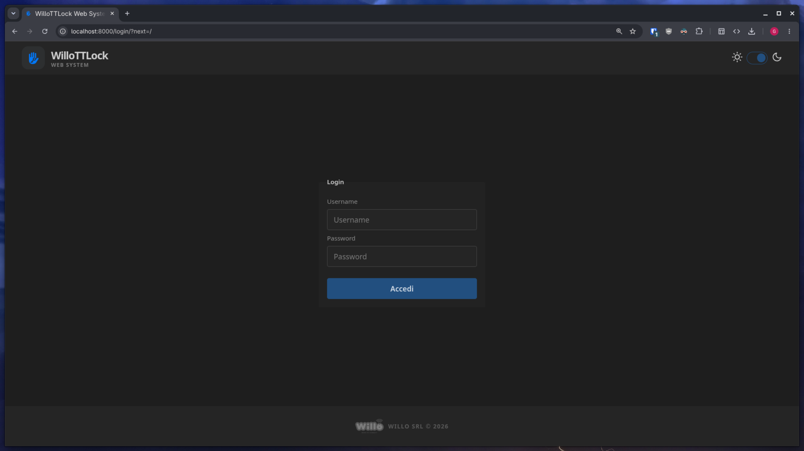

**Lock list**: each card shows the lock name, gateway status (online/offline) and battery level. The search bar filters locks by name; the sync button reloads them from TTLock.

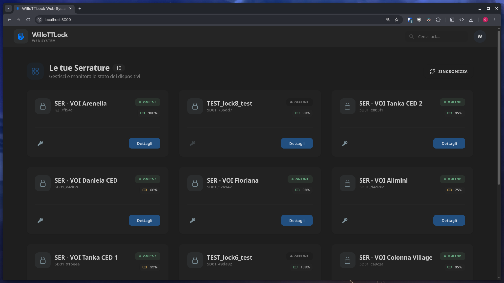

**Lock details**: clock, open/closed state and battery, with two tabs for passcodes and logs. `N/D` (not available) appears when the lock is offline.

<table>
  <tr>
    <th width="50%">Passcodes tab</th>
    <th width="50%">Logs tab</th>
  </tr>
  <tr>
    <td>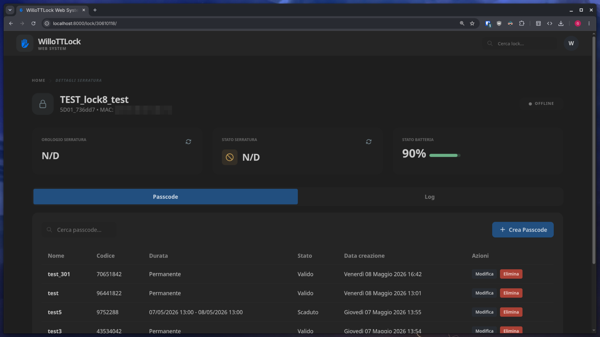</td>
    <td>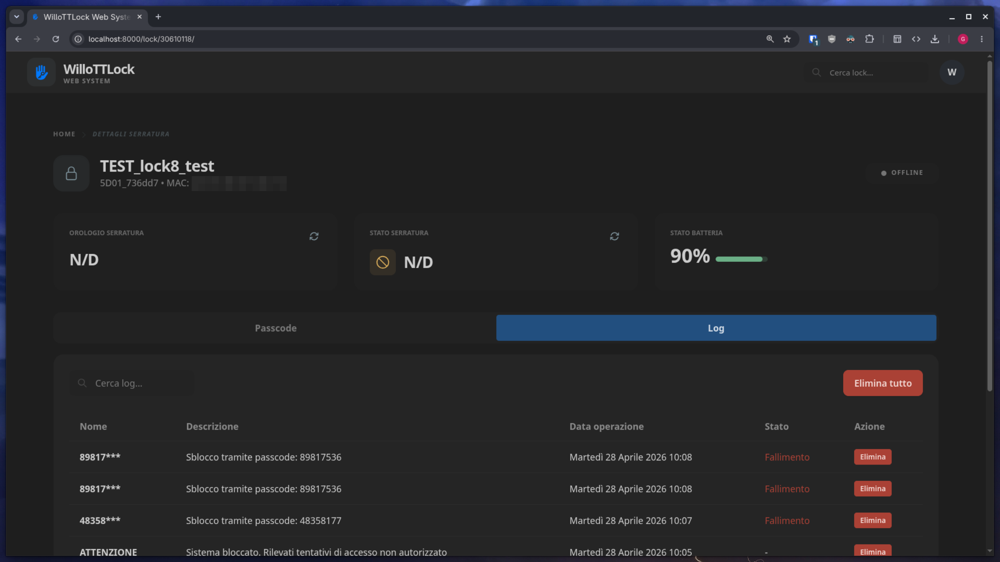</td>
  </tr>
</table>

**Create passcode**: random or custom code; the date fields appear only for timed passcodes.

<table>
  <tr>
    <th width="50%">Random, timed</th>
    <th width="50%">Custom, permanent</th>
  </tr>
  <tr>
    <td>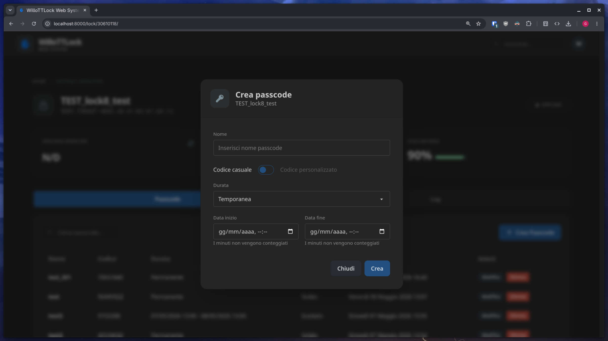</td>
    <td>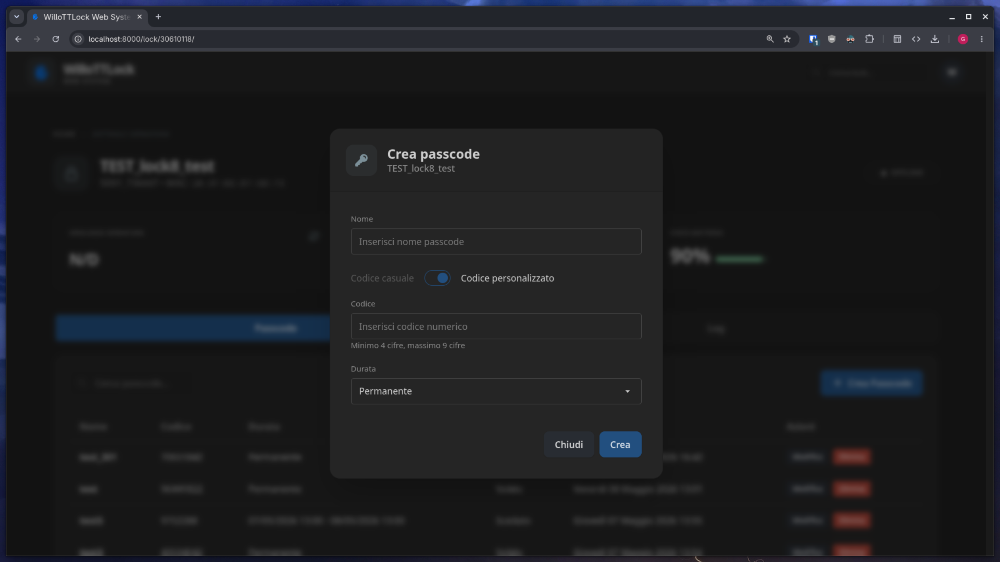</td>
  </tr>
</table>

## Tech stack

| Layer    | Technology                                                    |
| -------- | ------------------------------------------------------------- |
| Backend  | Python 3, Django 6, `requests`, `python-decouple`             |
| Database | PostgreSQL (SQLite in-memory for tests)                       |
| Frontend | Django templates + template partials, HTMX, Alpine.js         |
| Styling  | Tailwind CSS 4 + daisyUI 5 (via CDN), `nord` / `business` themes |
| Security | `django-axes` for brute-force protection                      |

## Architecture

### Overview

The app is a server-rendered Django project. It has no REST API of its own: the browser talks to Django through HTMX, and Django returns HTML fragments. Django talks to TTLock through a single service class, `TTLockAPI`.

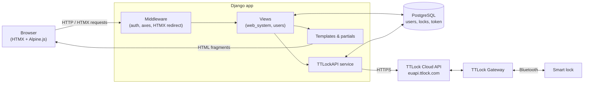

Most operations (state, clock, passcode changes) need the lock to be reachable through a gateway. When the gateway or lock is offline, TTLock returns an error code and the view shows a specific message.

### Project structure

```
ttlock/                    # project settings and root URL config
users/                     # custom User model, login/logout views, axes lockout view
web_system/                # main app
├── models.py              # Lock, TTLockToken, LockManager
├── views.py               # all lock / passcode / log views
├── forms.py               # PasscodeForm, EditPasscodeForm, RenameLockForm
├── decorators.py          # @lock_ownership_required
├── middleware.py          # HtmxAuthRedirectMiddleware
├── services/ttlock_api.py # TTLock API client
├── templates/             # pages and partials
└── tests/                 # model, form and view tests
templates/                 # base layout, navbar, footer
static/                    # images and htmx.min.js
```

### Data model

The local database stores very little. Lock data, passcodes and logs always come live from TTLock. The database only keeps who owns which lock and the OAuth token.

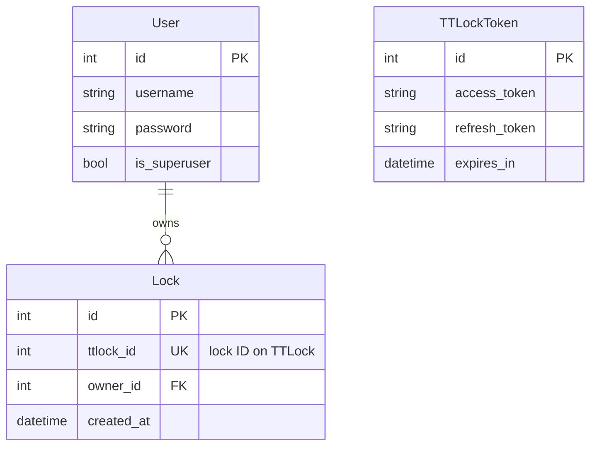

`TTLockToken` holds a single row, shared by all users.

### Request lifecycle

Every request to a lock goes through the same chain of checks before it reaches TTLock.

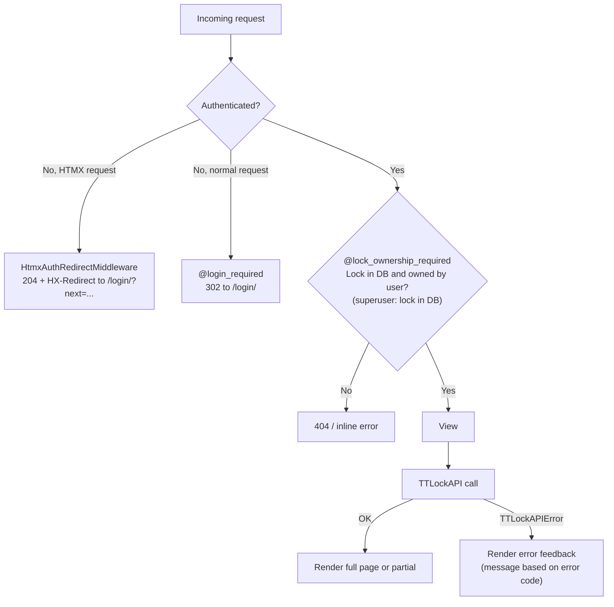

`HtmxAuthRedirectMiddleware` exists because HTMX follows a 302 silently and swaps the login page into the current fragment. The middleware replaces the redirect with an `HX-Redirect` header, so the browser does a full navigation to the login page. The `next` parameter keeps the original path.

### Lock assignment

TTLock has no concept of the app's users. The app maps locks to users by **lock name**: a lock whose alias starts with `<username>_` (case-insensitive) belongs to that user.

`LockManager.sync_with_api()` runs when the home page loads or when the user presses the sync button:

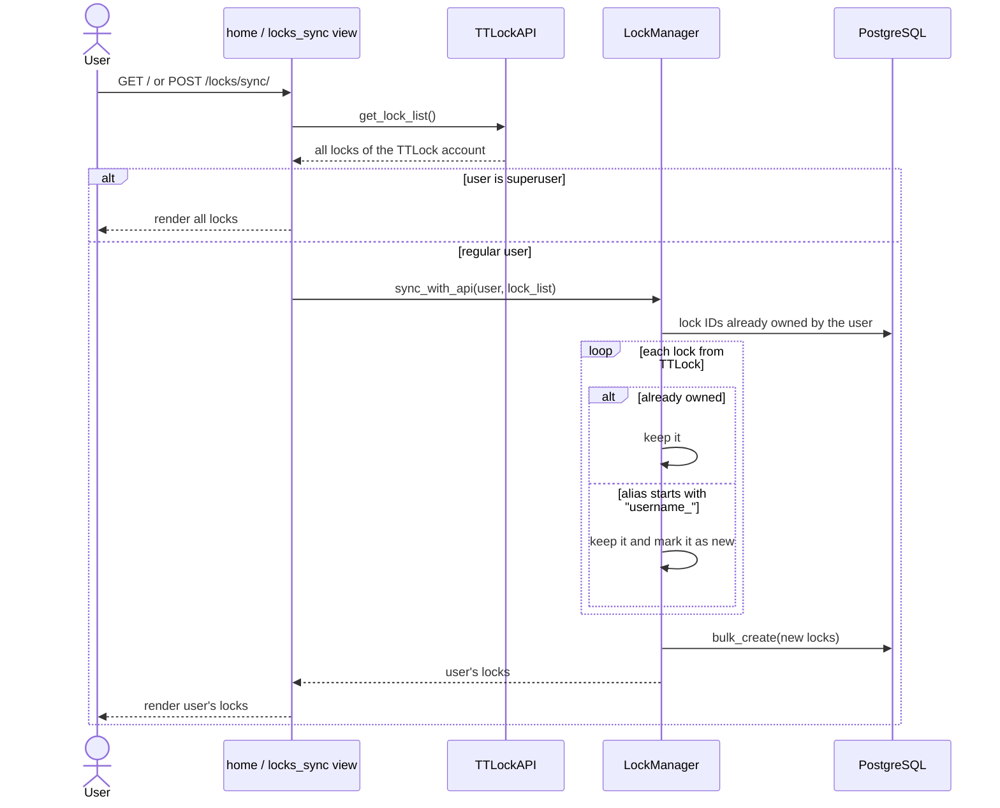

Once a lock is saved in the database, it stays assigned to the user even if it is renamed later.

### TTLock API client

`web_system/services/ttlock_api.py` wraps every TTLock call. Its `_request()` method:

- adds `clientId` and `date` (a timestamp in milliseconds) to each request, as TTLock requires;
- uses a 10-second timeout;
- raises `TTLockAPIError(message, error_code)` when TTLock returns `errcode != 0`, or with code `-1` on network or HTTP errors.

The views catch `TTLockAPIError` and turn known error codes into user messages, for example `-3002` (gateway offline), `-3009` (no space for new passcodes) or `-3006` (invalid passcode length).

The access token is managed transparently:

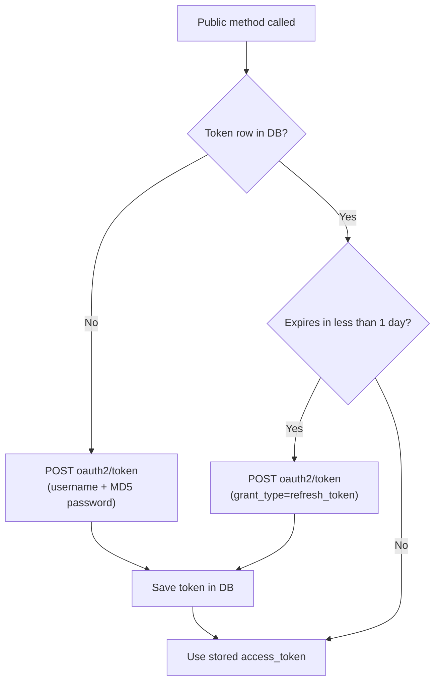

### Frontend

Pages render with Django 6 [template partials](https://docs.djangoproject.com/en/6.0/ref/templates/language/#template-partials) (``). The same view returns either the full page or only a fragment:

- **Normal request** (reload, direct URL): renders the full page, for example `home.html`.
- **HTMX request** (`HX-Request` header): renders only a partial, for example `home.html#lock_list`, and swaps it into `#main-content`. `hx-push-url` keeps the browser URL in sync.

Other patterns used in the UI:

- **Lazy loading**: on the lock page, the state and clock cards and the passcode tab load after the page with `hx-trigger="load"`.
- **Infinite scroll**: passcode and log lists load 10 rows per page; the last row has `hx-trigger="revealed"` and fetches the next page.
- **Response headers drive the swap**: views use `HX-Retarget`, `HX-Reswap` and `HX-Trigger` to show errors inside a modal, re-render a form with validation errors, or notify Alpine.js components (for example the `passcode-created` event).
- **Alpine.js** handles local UI state: modals, tabs, form fields enabled or disabled by passcode type, and date limits.

Forms are validated twice: in the browser (Alpine bindings, HTML `pattern`, `min`/`max`) and on the server (`clean()` in the Django forms). Server rules include: passcodes of 4–9 digits, timed passcodes with a start date not in the past, an end date after the start date, a maximum duration of one year, and times rounded to the hour.

## Endpoints

| Method | URL                                          | Description                         |
| ------ | -------------------------------------------- | ----------------------------------- |
| GET/POST | `/login/`                                  | Login                               |
| GET    | `/logout/`                                   | Logout                              |
| GET    | `/`                                          | Lock list                           |
| POST   | `/locks/sync/`                               | Sync locks with TTLock              |
| GET    | `/lock/<lock_id>/`                           | Lock details                        |
| POST   | `/lock/<lock_id>/rename/`                    | Rename lock                         |
| GET    | `/lock/<lock_id>/state/`                     | Open/closed state                   |
| GET    | `/lock/<lock_id>/time/`                      | Lock clock                          |
| POST   | `/lock/<lock_id>/sync/time/`                 | Sync lock clock                     |
| GET    | `/lock/<lock_id>/passcodes/?page=N`          | Passcode list                       |
| POST   | `/lock/<lock_id>/passcode/`                  | Create passcode                     |
| POST   | `/lock/<lock_id>/passcode/<id>/edit/`        | Edit passcode                       |
| DELETE | `/lock/<lock_id>/passcode/<id>/delete/`      | Delete passcode                     |
| GET    | `/lock/<lock_id>/logs/?page=N`               | Log list                            |
| DELETE | `/lock/<lock_id>/logs/<id>/delete/`          | Delete one log record               |
| DELETE | `/lock/<lock_id>/logs/clear/`                | Clear all log records               |
| —      | `/admin/`                                    | Django admin (users, locks)         |

## Setup

Requirements: Python 3, PostgreSQL and a [TTLock developer account](https://euopen.ttlock.com/) (client ID and client secret).

```bash
python -m venv .venv
source .venv/bin/activate
pip install -r requirements-dev.txt
```

Create a `.env` file in the project root:

```env
SECRET_KEY=...
DEBUG=True
ALLOWED_HOSTS=localhost,127.0.0.1

DB_NAME=ttlock
DB_USER=...
DB_PASSWORD=...
DB_HOST=localhost
DB_PORT=5432

TTLOCK_USERNAME=...        # TTLock app username
TTLOCK_PASSWORD=...        # TTLock app password, as an MD5 hash
TTLOCK_CLIENT_ID=...       # developer account client ID
TTLOCK_CLIENT_SECRET=...   # developer account client secret
```

Then run:

```bash
python manage.py migrate
python manage.py createsuperuser
python manage.py runserver
```

### Adding users and locks

1. Create the user in the Django admin (`/admin/`).
2. In the TTLock app, rename the lock to `<username>_<anything>`, for example `VOI_front-door`.
3. The user logs in: the lock is assigned on the first page load, or after pressing the sync button.

Locks cannot be added from the admin. The admin shows them as read-only.

## Tests

Tests use an in-memory SQLite database, so PostgreSQL is not needed. TTLock calls are mocked.

```bash
python manage.py test
```

With coverage:

```bash
coverage run manage.py test
coverage report        # or: coverage html
```
